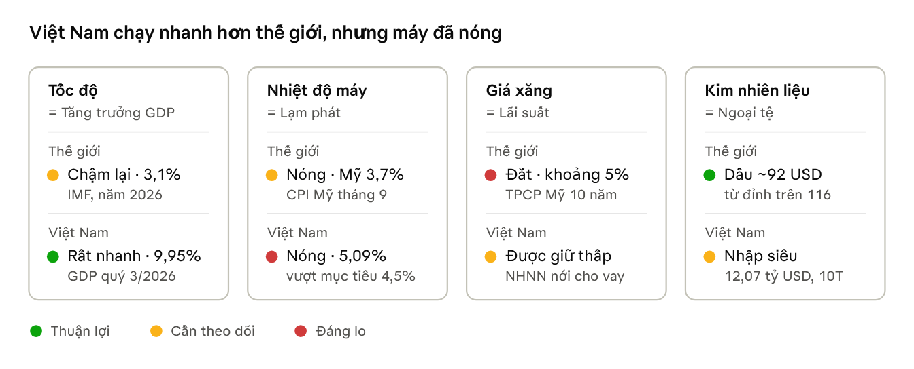
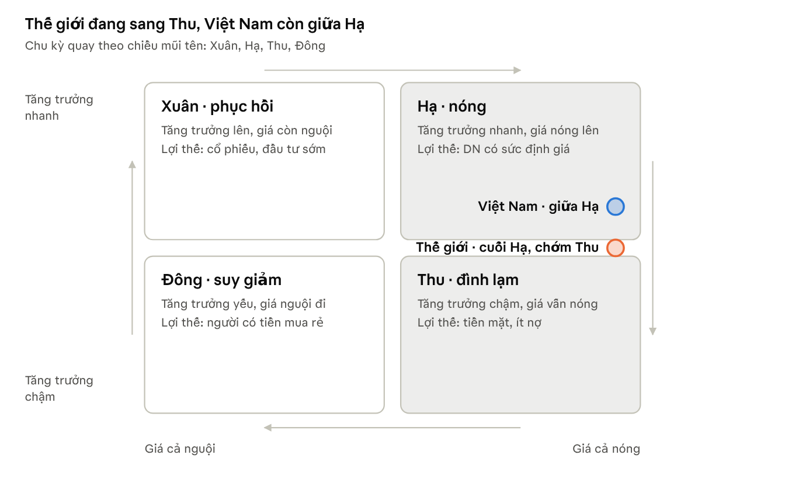

*Kinh tế vĩ mô* · Nhật ký quân vương · Tư Mã Đại Nhân

*Series "Tiền đắt, máy nóng" — Kỳ 1/3 · Đọc trong khoảng 5 phút*

Một buổi sáng, cậu em làm văn phòng hỏi Tư Mã: "Anh ơi, báo bảo kinh tế tăng trưởng gần 10%, sao em đi chợ thấy càng ngày càng đắt, chứng khoán thì đứng im, mà vay mua nhà vẫn khó?"

Câu hỏi ấy đúng là chìa khóa. Series 3 kỳ này trả lời nó bằng lời thường. Kỳ 1 trao cho bạn hai công cụ: bốn chiếc đồng hồ để đọc nền kinh tế, và bốn mùa để biết mình đang đứng ở đâu.

## Bốn chiếc đồng hồ

Ai lái xe cũng nhìn bốn đồng hồ trên táp-lô. Nền kinh tế cũng vậy:

- Tốc độ = tăng trưởng GDP. Xe chạy nhanh hay chậm.
- Nhiệt độ máy = lạm phát. Giá cả tăng nhanh là máy đang nóng.
- Giá xăng = lãi suất. Đây là giá của đồng tiền. Lãi cao thì mọi thứ vay mượn đều đắt.
- Kim nhiên liệu = ngoại tệ. Bán ra nước ngoài nhiều hơn mua vào thì bình đầy; ngược lại thì tụt.

*Đồ họa: Tư Mã Đại Nhân*

Bây giờ nhìn vào táp-lô hôm nay (số liệu đến 27/11/2026):

| Đồng hồ | Thế giới | Việt Nam |
| --- | --- | --- |
| Tốc độ | Chậm lại: 3,5% (2025) → 3,1% (2026, IMF) | Rất nhanh: 9,95% quý 3, 9,01% 9 tháng |
| Nhiệt độ máy | Nóng: Mỹ 3,7% (tháng 9) | Nóng: 5,09% (tháng 10), bình quân 10 tháng 4,57%, vượt mục tiêu 4,5% |
| Giá xăng | Đắt: Fed 3,75–4%, đã tăng lại; lợi suất trái phiếu Mỹ 10 năm khoảng 5% | Đang được giữ thấp: NHNN yêu cầu giảm lãi, nới giới hạn cho vay |
| Kim nhiên liệu | Dầu đã hạ từ trên 116 USD xuống khoảng 92 USD | 10 tháng nhập siêu 12,07 tỷ USD; cùng kỳ năm ngoái xuất siêu 19,49 tỷ USD |

Việt Nam chạy nhanh nhất khu vực: GDP quý 3 tăng 9,95%, cao nhất cùng kỳ kể từ quý III/2023. Nhưng nhiệt độ máy đã đỏ: CPI bình quân 10 tháng tăng 4,57%, vượt mục tiêu khoảng 4,5% Quốc hội đặt ra. Kim nhiên liệu cũng đang vàng: 10 tháng nhập siêu 12,07 tỷ USD, trong khi cùng kỳ năm ngoái xuất siêu 19,49 tỷ USD.

Người lái giỏi, khi thấy máy nóng và nhiên liệu tụt, sẽ nhấc chân ga một chút. Người lái vội thì đạp thêm.

## Chúng ta đang ở mùa nào?

Kinh tế chạy theo chu kỳ, giống bốn mùa. Chỉ cần hỏi hai câu: tăng trưởng đang nhanh hay chậm, và giá cả đang nóng hay nguội. Mỗi mùa có người thắng riêng.

*Đồ họa: Tư Mã Đại Nhân*

| Mùa | Tăng trưởng | Giá cả | Ngân hàng trung ương thường làm gì | Ai thắng |
| --- | --- | --- | --- | --- |
| Xuân (phục hồi) | Tăng dần | Còn nguội | Giữ lãi thấp | Cổ phiếu, người dám đầu tư sớm |
| Hạ (nóng) | Nhanh | Nóng lên | Bắt đầu tăng lãi | Hàng hóa, doanh nghiệp có sức định giá |
| Thu (đình lạm) | Chậm lại | Vẫn nóng | Giữ lãi cao | Tiền mặt, người ít nợ |
| Đông (suy giảm) | Yếu | Nguội đi | Cắt lãi | Trái phiếu, người có tiền để mua tài sản rẻ |

Tư Mã Đại Nhân định vị (nhận định dựa trên bốn đồng hồ ở trên):

- **Thế giới: cuối Hạ, chớm Thu.** IMF dự báo tăng trưởng toàn cầu chậm từ 3,5% (2025) xuống 3,1% (2026). Nhưng giá cả vẫn nóng, nên tháng 9 Fed đã phải tăng lãi suất lần đầu sau hơn ba năm. Đây là giai đoạn khó chịu nhất: kinh tế chậm mà tiền vẫn đắt.
- **Việt Nam: giữa Hạ.** Tăng trưởng còn tăng tốc qua từng quý (8,15% → 8,81% → 9,95%), giá cả nóng lên, nhưng chính sách vẫn đang nới để giữ đà.

Việt Nam là nền kinh tế rất mở: xuất nhập khẩu 10 tháng đã vượt 1.000 tỷ USD. Khi thế giới sang Thu, Việt Nam khó giữ mãi mùa Hạ. Câu hỏi không phải có hạ nhiệt hay không, mà hạ nhiệt êm hay gắt.

## Điều này chạm đến bạn thế nào

Trở lại câu hỏi của cậu em:

- "Sao đi chợ đắt?" Vì nhiệt độ máy đang cao. Tháng 10 CPI tăng 5,09% so cùng kỳ: cùng một giỏ hàng, năm nay đắt hơn khoảng 5%.
- "Sao chứng khoán đứng im?" Vì giá xăng thế giới đắt. Trái phiếu Mỹ trả khoảng 5%/năm gần như không rủi ro, nên nhà đầu tư ngoại chưa vội quay lại. Riêng tháng 10 họ bán ròng 24.024 tỷ đồng cổ phiếu Việt Nam.
- "Sao vay mua nhà vẫn khó?" Lãi vay mua nhà cố định 1–2 năm đầu đã giảm về 9–10,7%/năm trong tháng 10, nhưng hết ưu đãi có thể lên 13–16%. Mức đó vẫn nặng với thu nhập bình quân người lao động quý III 9,2 triệu đồng/tháng.

Nhớ một câu: **tăng trưởng cao chưa chắc là cuộc sống dễ hơn. Phải nhìn cả bốn đồng hồ, không chỉ đồng hồ tốc độ.**

**Kỳ sau:** [Ba chuyện của thế giới, ba đèn vàng của Việt Nam](/binh-phap-cong-so/ba-chuyen-the-gioi-ba-den-vang/) — tiền đắt, AI bị định giá lại, Trung Quốc thừa hàng, ba đèn vàng của Việt Nam, và cơ hội nằm ở đâu trong những rủi ro ấy.

### Từ điển nhỏ của kỳ này

- **GDP:** tổng sản phẩm cả nước làm ra. GDP tăng 9% = "cái bánh" to hơn 9% so với năm trước.
- **CPI, lạm phát:** mức tăng giá của một giỏ hàng tiêu dùng.
- **Fed:** ngân hàng trung ương Mỹ. Fed tăng lãi thì cả thế giới thấy tiền đắt hơn.
- **Nhập siêu:** mua của nước ngoài nhiều hơn bán cho họ. Kéo dài thì thiếu USD, tỷ giá dễ tăng.
- **Đình lạm:** kinh tế chậm mà giá cả vẫn tăng, tức mùa Thu.

Nguồn: IMF (T10/2026), Cục Thống kê (T10/2026), AP/NPR về Fed, BLS, Dow Jones, Vietcap. Bài thể hiện quan điểm cá nhân, không phải khuyến nghị đầu tư.
